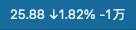
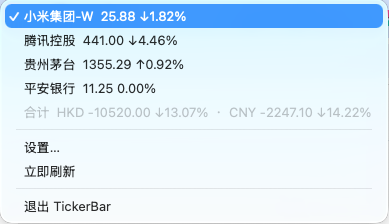
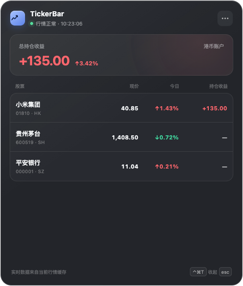
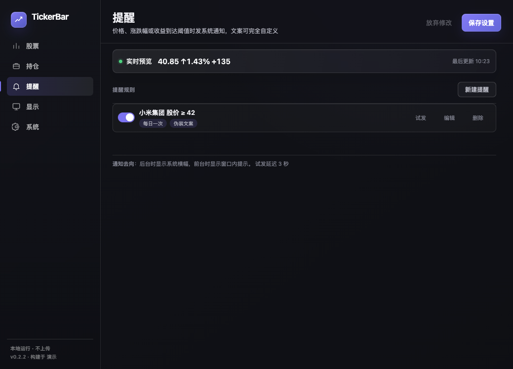
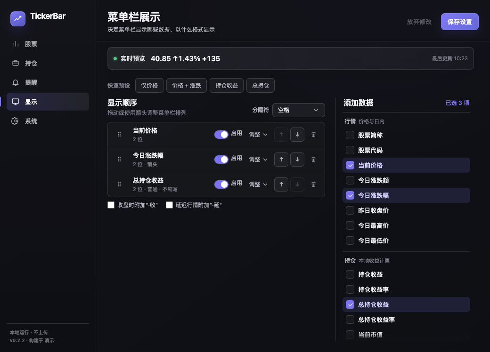
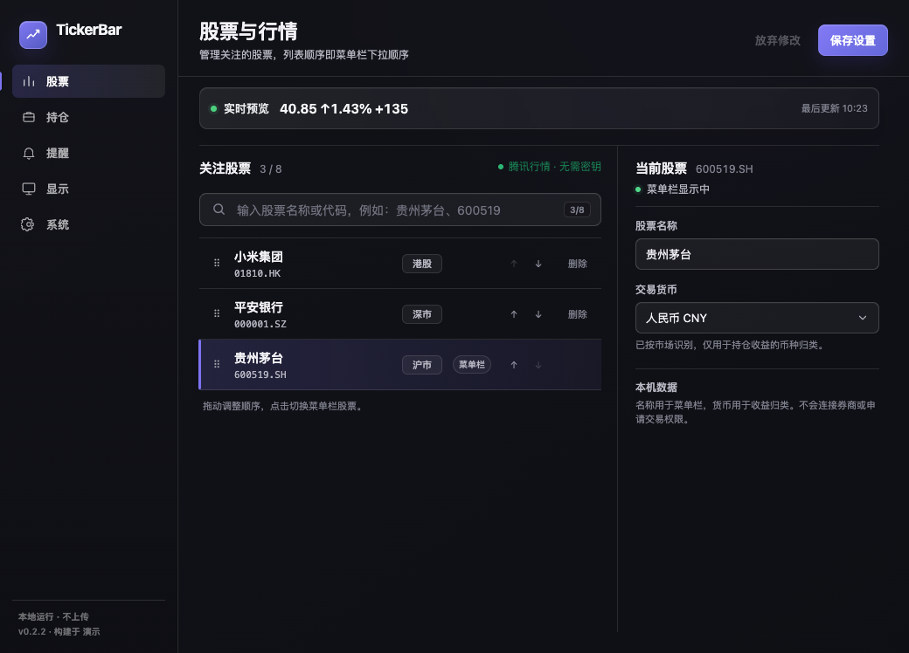

# TickerBar

在 macOS 菜单栏显示股票价格、涨跌和持仓收益的本地工具。没有常驻主窗口，也不显示 Dock 图标。

行情来自腾讯免费接口，无需注册、无需密钥、不登录券商账户。



就是菜单栏上这一小条。显示哪些数据、什么格式，都可以自己定。

> 下方截图中的股票与持仓均为演示数据。

## 功能

### 点开看全部持仓



最多 8 只股票，默认每 3 秒批量刷新一次；网络异常时自动降低重试频率。点任意行即可切换菜单栏显示哪只。

**多币种按币种分开合计，绝不相加**——没有汇率数据源，港币与人民币混加只会得出看似精确的错误数字。

### 菜单栏放不下？用快捷键速览



默认按 `⌃⌘T`（Control + Command + T）打开速览，再按一次或按 Esc 收起。即使菜单栏项目被其他应用挤掉，也能查看行情和持仓；点速览右上角的「⋯」进入设置。可在「设置 → 系统」换绑或关闭快捷键，默认持仓排在前面。

### 到价提醒


价格、涨跌幅、持仓收益到达阈值时发系统通知。采用**穿越触发**——回落后再次越过才响，不会在阈值附近反复轰炸。

通知文案可完全自定义（比如换成「今天吃了三斤肉」），也可以设为静默。休市期间用「试发」就能验证通知链路，不必等开盘。



### 菜单栏显示什么，自己定



18 种数据项任意勾选与排序，包含单股收益、总持仓收益及对应收益率；精度、正负号、万/亿缩写逐项可调。已选项可直接暂停或删除，暂停时保留排序与格式配置，改动即时反映在顶部预览里。

总持仓只有一种币种时直接显示 `总盈+1.2万`；存在多种币种时才分别标记，例如 `HKD总盈+1.2万/CNY总盈-800`。任一持仓行情尚未更新时会显示“总盈待更新”，不会把残缺结果当成完整合计。

按交易时段与行情时间戳区分 交易中 / 休市 / 延迟（A 股与港股分别判定）。

### 股票与持仓



搜索添加，拖动排序，列表顺序即菜单栏下拉的顺序。每只股票可单独填写持仓数量与成本，收益全部在本地算。

## 安装

1. 从项目的 [GitHub Releases](https://github.com/Daytimestill/ticker-bar/releases) 下载该版本的 `.dmg`（不要选 Source code 源码压缩包）。带有 `universal` 的安装包同时包含 Apple Silicon 和 Intel 版本。最低部署目标为 macOS 13，已实测的系统以对应版本的发布说明为准。
2. 打开 DMG，把 TickerBar 拖到「应用程序」，再从「应用程序」打开。**测试包未经 Apple 公证**，macOS 可能拦截。如果确认来源可信且完整性校验一致，可自行参考 [Apple 的安全说明](https://support.apple.com/zh-cn/102445)；不要关闭系统保护。如果不接受未公证的程序，建议[从源码自行构建](#开发)或等待签名、公证的版本。
3. 首次启动会显示引导。到「股票」搜索并添加标的，按需填写持仓或设置提醒，最后点击「保存设置」。TickerBar 是菜单栏应用，关闭设置窗口后仍在运行。

若该版本提供 `SHA256SUMS.txt`，把它和 DMG 放在同一个目录，在该目录运行 `shasum -a 256 -c SHA256SUMS.txt`；显示 `OK` 表示文件与发布方提供的校验值一致，不代表 Apple 已公证。

### 升级与常见问题

- **升级后确认版本**：先从菜单栏退出旧程序，再用新包替换「应用程序」里的 TickerBar，不要直接从 DMG 启动旧副本。设置页左下角显示版本和构建时间。升级通常保留原配置，重要持仓建议先备份下方所列的配置文件。
- **菜单栏找不到 TickerBar**：先试 `⌃⌘T`；如果快捷键也无反应，可以再次打开「应用程序」里的 TickerBar 唤出设置，在「系统」检查快捷键是否启用或被占用。
- **重启后没有自动启动**：打开「设置 → 系统」，开启登录启动并保存；如仍无效，检查 macOS 是否禁用了 TickerBar 的登录项。
- **没有收到提醒**：在「提醒」页先用「试发」确认，检查系统的通知权限和专注模式。设置窗口在前台时，提醒也会显示在窗口内。
- **行情没更新**：先在设置页看最后更新时间与错误提示；断网后会自动重试。行情来自第三方公开接口，休市或接口异常时不保证实时。

遇到问题可[提交反馈](https://github.com/Daytimestill/ticker-bar/issues/new)：请注明 macOS 版本、芯片、设置页显示的版本和复现步骤。不要公开上传 `config.json`、持仓或账号信息。

## 数据与隐私

这是一个纯本地工具，**没有账号体系、没有服务端、没有遥测、没有崩溃上报、没有第三方 SDK**。

**留在本机的数据**——股票列表、持仓数量与成本、提醒规则、显示偏好，明文 JSON 存放于：

```
~/Library/Application Support/com.neza.tickerbar/config.json
```

文件权限为 `0600`（仅当前系统用户可读写）。持仓数据不加密，仅靠文件系统权限保护——对单用户本机小工具是合理取舍，但请知悉。

保存设置或迁移配置时会把上一版配置保留为同目录下的 `config.json.bak`；正常重启不会轮换备份。需要恢复时，先退出应用，把当前 `config.json` 另存一份，再将确认可用的备份复制为 `config.json`。不要用更旧的安装包验证新配置，旧版本的兼容行为可能不同。

**会发出去的请求**——只有两类，都发往腾讯公开行情接口：

| 用途 | 地址 | 携带内容 |
|------|------|----------|
| 拉取行情 | `https://qt.gtimg.cn/q=...` | 股票代码 |
| 搜索股票 | `https://smartbox.gtimg.cn/s3/...` | 你输入的关键词 |

请求不带 Cookie、不带用户标识、不需要登录。User-Agent 只包含应用名与版本号，不含用户名或设备信息。**持仓数量与成本永远不会离开本机**——收益全部在本地计算。

短暂断网时，最近一次错误会保留在菜单栏提示中并自动重试；如果没有主动选择“市场状态”字段，菜单栏正文不会额外插入 `!` 或 `↻`。启用“市场状态”后则会用“断 / 连”等明确文字展示连接情况。

## 免责声明

行情来自腾讯免费公开接口，可能存在延迟、中断或错误，**仅供参考，不构成任何投资建议**。本工具不对数据准确性作任何担保，据此产生的任何投资决策与损失由使用者自行承担。

该接口为腾讯提供的公开服务。本项目用于个人行情查询，每轮批量请求，失败时按指数退避。接口的可用性与使用条款由腾讯决定，随时可能变化。

## 开发

```bash
pnpm install --frozen-lockfile
pnpm tauri dev                # 开发模式
pnpm release                  # 构建 Universal 包（Apple Silicon + Intel）
```

构建产物在 `src-tauri/target/universal-apple-darwin/release/bundle/`。默认使用 ad-hoc 签名，不等于 Apple 公证；正式分发流程和人工验收项见[发布检查表](docs/RELEASING.md)。

## 质量检查

```bash
pnpm test:coverage            # 前端测试 + 覆盖率
pnpm build                    # 类型检查 + 构建

cd src-tauri
cargo test
cargo clippy --all-targets -- -D warnings
cargo fmt --check
cargo audit
```

## Windows 版？

目前只有 macOS 版。想做的话，[`docs/WINDOWS_PORT.md`](docs/WINDOWS_PORT.md) 讲清了难在哪、要做什么、有哪些坑。

结论先放这儿：**代码层面移植不难，难的是产品形态得重新设计。** 业务逻辑全是平台无关的，但 **Windows 系统托盘不支持显示文字**（`tray-icon` crate 标注 `Windows: Unsupported`），而「不打开任何窗口、扫一眼就知道现在多少钱」正是这个应用的立身之本。文档里给了三个方向和各自的代价。

## 技术栈

Tauri 2（Rust 后端 + Vue 3 前端），行情计算使用 `rust_decimal` 避免浮点误差。

## 许可

[MIT](LICENSE)
